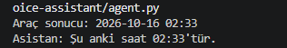
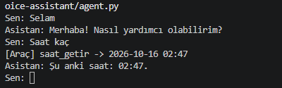
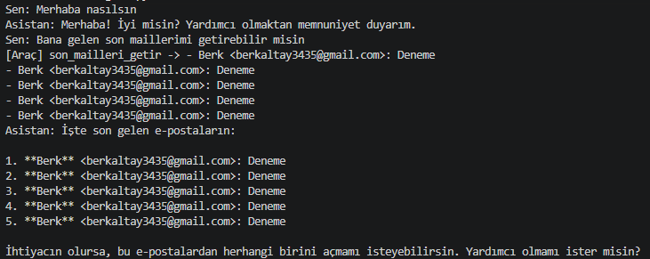
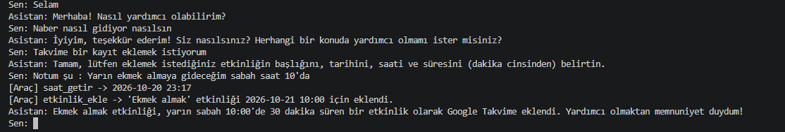

<h1 align="center">Local Voice Assistant</h1>

  Türkçe konuşan, verilerin kendi bilgisayarımda kaldığı kişisel yapay zekâ asistanı.

## Amaç

Mail, takvim ve notlarınla ilgilenen, sesle konuşabildiğin bir asistan yapmak. Yapay zekâ modeli tamamen yerelde çalışır, verilerin buluta gönderilmez.

## Durum

- [x] Yerel modelle (Qwen3 14B) Python'dan konuşma
- [x] Modelin araç çağırması (tool calling)
- [x] Araç kullanan ajan döngüsü
- [x] Araçları `tools/` paketi altında modüler yapıya taşıma
- [x] Not alma aracı (not_ekle, notlari_listele)
- [x] Uygulama açma aracı (uygulama_ac)
- [x] Google OAuth kimlik doğrulama (google_auth.py)
- [x] Gmail entegrasyonu (son_mailleri_getir)
- [x] Google Takvim entegrasyonu (etkinlik_ekle, yaklasan_etkinlikler)
- [x] Sesli giriş — Speech-to-Text (faster-whisper, yerel)
- [x] Sesli çıkış — Text-to-Speech (piper, yerel, Türkçe)
- [x] Mikrofon → model → sesli cevap tam döngüsü (ses.py + agent.py entegrasyonu)

## Geliştirme Süreci

Projenin nasıl adım adım geliştiğinin kısa özeti:

1. Ollama ile Python üzerinden konuşmayı sağlayan temel fonksiyon yazıldı, modelin cevap üretmesi test edildi.

2. Modelin araç (tool) çağırabilmesi için gerekli altyapı kuruldu: araçları tutan bir sözlük yapısı oluşturuldu, modelin bir araç istediğinde onu bulup çalıştıran ve sonucu tekrar modele veren bir döngü yazıldı. Böylece model artık konuşma sırasında ihtiyaç duyduğunda araç çağırabilir hale geldi.

3. Araçlar, tek bir dosyada toplanmak yerine ayrı bir `tools/` paketi altına taşınarak modüler hale getirildi. İlk araçlar olarak güncel saat/tarih bilgisini döndüren bir araç, ve not alma/notları listeleme araçları eklendi.

4. Bilgisayarda yaygın kullanılan uygulamaları (not defteri, hesap makinesi, tarayıcı, dosya gezgini vb.) açabilen bir araç eklendi — asistan artık sesli/yazılı istek üzerine bilgisayarda bir uygulama başlatabiliyor.

5. Google hesabına bağlanabilmek için ortak bir OAuth kimlik doğrulama fonksiyonu yazıldı. Bu altyapı üzerine Gmail'den son mailleri getiren bir araç, ve Google Takvim'e etkinlik ekleyen/yaklaşan etkinlikleri listeleyen araçlar eklendi.

6. Proje başka bir bilgisayara taşınırken eksik kalan kurulum adımları tamamlandı: Python bağımlılıkları (`requirements.txt`) kuruldu, Google Cloud Console üzerinden OAuth istemci bilgileri (`credentials.json`) yeniden alınıp projeye eklendi. Böylece mail ve takvim araçları yeni makinede de çalışır hale geldi.

7. Testler sırasında modelin "yarın" gibi göreceli tarih ifadelerini yanlış hesapladığı (gerçek tarihle ilgisi olmayan bir tarih uydurduğu) fark edildi. Modele genel bir kural veren bir system prompt eklendi, ayrıca takvim aracının açıklaması güçlendirilerek, göreceli tarih ifadelerinde önce güncel tarihi öğrenmesi sağlandı. Düzeltme sonrası doğru tarihte etkinlik eklendiği doğrulandı.

8. Sesli girişi/çıkışı sağlayacak kütüphaneler kuruldu: `faster-whisper` (ses→metin), `sounddevice` + `numpy` (mikrofon kaydı için), `piper-tts` (metin→ses). Kurulum sırasında yavaş/kararsız internet bağlantısı kaynaklı indirme hataları yaşandı, tekrar denenerek aşıldı.

9. Piper'ın Türkçe konuşabilmesi için bir Türkçe ses modeli (`tr_TR-dfki-medium`) indirilip `voices/` klasörüne eklendi. Bu model dosyaları büyük ve kişisel kuruluma özel olduğu için `.gitignore`'a `voices/` ve test sırasında oluşacak `*.wav` dosyaları eklendi.

10. Piper'ın terminal üzerinden çalışıp çalışmadığı, Python koduna geçmeden önce komut satırından test edildi (`piper --model ... --output_file test.wav`). Oluşan ses dosyası dinlendi, Türkçe çıktının anlaşılır olduğu doğrulandı.

11. `faster-whisper` dosya üzerinden test edilirken bir hatayla karşılaşıldı: kütüphanenin ses dosyalarını okumak için kullandığı `av` paketinin kurulu sürümü, `faster-whisper`'ın beklediği eski bir özellik ile uyumsuzdu. Eski sürüme geçiş denendi ama bu sürümün yeni Python sürümüyle derleme sorunları çıktı. Çözüm olarak, ses verisinin dosyaya hiç yazılmadan doğrudan sayısal dizi (numpy array) olarak işlenmesi tercih edildi — bu hem sorunu ortadan kaldırdı hem de gerçek kullanım senaryosuna (mikrofon kaydı) daha uygun bir yöntem oldu.

12. STT, gerçek mikrofon girişiyle test edildi: `sounddevice` ile birkaç saniyelik kayıt alınıp doğrudan `faster-whisper`'a verildi. Konuşulan cümlenin doğru dilde (Türkçe) ve büyük ölçüde doğru şekilde metne çevrildiği doğrulandı.

13. Test edilen STT ve TTS mantığı, kalıcı bir modül olan `ses.py` içine taşındı. İki fonksiyon tanımlandı: `dinle()` — mikrofondan kayıt alıp metne çevirir; `konus(metin)` — verilen metni Türkçe sese çevirip hoparlörden çalar. Performans için model nesneleri (Whisper ve Piper) dosya yüklenirken bir kez oluşturulacak şekilde ayarlandı, her çağrıda yeniden yüklenmeyecek şekilde yapılandırıldı.

14. `ses.py`'deki `dinle()` ve `konus()` fonksiyonları `agent.py`'nin ana döngüsüne bağlandı: klavyeden okuma yerine mikrofondan dinleme, ekrana yazma yanında sesli okuma eklendi. Sistem uçtan uca test edildi — mikrofona söylenen bir istek metne çevrildi, modele iletildi, gerektiğinde araç (mail, takvim, not vb.) kullanılarak bir cevap üretildi ve bu cevap hem ekrana yazıldı hem sesli olarak okundu. Böylece proje, tamamen metin tabanlı bir asistandan, sesli konuşulabilen bir asistana dönüştü.

## Ekran Görüntüleri

### İlk konuşma

### Sohbet ve hafıza

### Araç kullanımı (tool calling)

Model saati bilmiyor. `saat_getir` aracını çağırmak istiyor, sonucu alıp cevap yazıyor.

### Ajan döngüsü

Model gerektiğinde araç çağırıyor, gerekmediğinde doğrudan cevap veriyor. Konuşmayı da hatırlıyor.

### Mail entegrasyonu

Model, Gmail gelen kutusundaki son mailleri `son_mailleri_getir` aracıyla çekip özetliyor.

### Takvim entegrasyonu

Model, `etkinlik_ekle` ile Google Takvim'e yeni bir etkinlik ekliyor, `yaklasan_etkinlikler` ile de yaklaşan etkinlikleri listeliyor.

## Teknolojiler

- Python
- Ollama
- Qwen3 14B
- Google Gmail API
- Google Calendar API
- faster-whisper (Speech-to-Text, yerel)
- Piper (Text-to-Speech, yerel, Türkçe)
