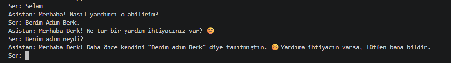

# Local Voice Assistant

Türkçe konuşan, verilerin kendi bilgisayarımda kaldığı kişisel yapay zekâ asistanı.

## Amaç

Mail, takvim ve notlarınla ilgilenen, sesle konuşabildiğin bir asistan yapmak. Yapay zekâ modeli tamamen yerelde çalışır, verilerin buluta gönderilmez.

## Durum

- [x] Yerel modelle (Qwen3 14B) Python'dan konuşma

## Teknolojiler

- Python
- Ollama
- Qwen3 14B

### İlk konuşma

### Sohbet ve hafıza

